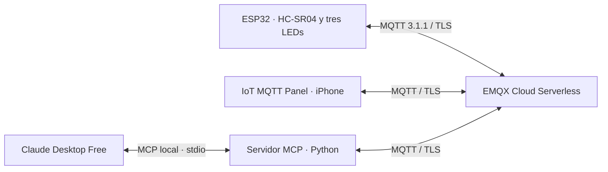

# SIS-234 · Equipo 08 · MQTT + MCP

Sistema IoT con ESP32 y HC-SR04 que publica distancias en EMQX Cloud y permite visualizarlas y controlar tres LEDs desde iPhone y Claude Desktop Free. Los LEDs se controlan mediante órdenes explícitas, sin automatismos por distancia.

## Integrantes

- Santiago Javier Torres Vacaflores.
- Ariel Adrian Mercado Alegre.

## Arquitectura



Todos los intercambios remotos con el ESP32 pasan por el broker. El servidor Python mantiene una conexión MQTT compartida y expone las herramientas que utiliza Claude.

## Tecnologías

| Componente | Tecnología |
|---|---|
| Hardware | DOIT ESP32 DEVKIT V1, HC-SR04 y tres LEDs |
| Firmware | C++, Arduino y PlatformIO; entorno Espressif32 7.0.1 / Arduino-ESP32 2.0.17 |
| MQTT en C++ | 256dpi/MQTT 2.5.2 |
| Broker y móvil | EMQX Cloud Serverless con TLS; IoT MQTT Panel para iOS |
| Servidor local | Python ≥3.11; entorno utilizado: 3.12.6 |
| Dependencias Python | SDK oficial MCP 2.3.0 (`MCPServer`), paho-mqtt 2.1.0 |
| IA | Claude Desktop Free mediante `stdio` |

## Estructura

```text
src/             Implementación del firmware y main.cpp
include/         Interfaces y plantillas públicas WiFi/MQTT
certificados/    CA pública para TLS
mcp_server/      Servidor Python, configuración de ejemplo y tests
docs/            Consigna, protocolo y guías de instalación y uso
platformio.ini   Placa, framework, bibliotecas y monitor Serial
.gitignore       Exclusiones de credenciales y archivos generados
```

## Contrato MQTT

Broker: `zffa4f2f.ala.us-east-1.emqxsl.com:8883`, con TLS y verificación de certificado y nombre. Prefijo: **`sis234/equipo08/esp32-01/`**; concatenarlo con cada sufijo de la tabla.

| Sufijo | Mensaje | QoS | Retain |
|---|---|---|---|
| `telemetry/distance_cm` | Decimal en cm, por ejemplo `24.6`; sin JSON | 0 | No |
| `telemetry/sensor_status` | `valid` o `invalid` | 0 | No |
| `cmd` | Uno de los once comandos | 1 | No |
| `state/rojo`, `state/amarillo`, `state/verde` | `on` u `off` | 1 | Sí |
| `availability` | `online` u `offline` | 1 | Sí |

Comandos: `rojo:on`, `rojo:off`, `amarillo:on`, `amarillo:off`, `verde:on`, `verde:off`, `todos:on`, `todos:off`, `solo:rojo`, `solo:amarillo`, `solo:verde`. Son idempotentes y se envían sin Retain. Las órdenes de grupo se reflejan en los tres estados individuales.

El [protocolo completo](docs/protocolo_mqtt.md) describe sus efectos y las garantías de entrega: PUBACK confirma recepción del broker; los estados informados no comprueban iluminación física. Un timeout no cancela una publicación.

## Herramientas MCP

| Herramienta | Parámetros públicos | Propósito |
|---|---|---|
| `verificar_conexion` | Ninguno | Devuelve `Servidor MCP del equipo 08 disponible`; comprueba el servidor local. |
| `leer_distancia` | Ninguno | Consulta la distancia reciente o informa su ausencia, invalidez o desconexión. |
| `controlar_led` | `color`: rojo/amarillo/verde/todos; `accion`: encender/apagar; `solo`: booleano opcional, `false` | Envía una orden y distingue recepción del broker de estados coincidentes. |
| `consultar_leds` | Ninguno | Consulta estados conocidos/desconocidos, antigüedad y disponibilidad. |

`solo=true` permite únicamente encender un color individual. No se aceptan parámetros adicionales. Claude interpreta las instrucciones; ante ambigüedad debe solicitar aclaración. Véase la [guía de control](docs/control_leds_mcp.md).

## Requisitos no funcionales declarados

Estos valores son **objetivos del proyecto, no resultados de mediciones cuantitativas**.

| Atributo | Objetivo |
|---|---|
| Estabilidad | ≥10 minutos continuos sin reinicios ni bloqueos. |
| Exactitud | Error máximo de ±3 cm respecto a una referencia física; rango nominal declarado: 2–400 cm. |
| Respuesta | ≤1 s desde la aplicación móvil hasta la actuación del ESP32, pasando por el broker. |
| Publicación | ≥2 lecturas válidas publicadas/s con sensor válido y conectividad estable; programación cada 500 ms. |
| Reconexión | Restablecer WiFi y MQTT automáticamente, sin intervención manual. |
| Seguridad | TLS verificado y credenciales locales excluidas de Git. |
| Código | POO, responsabilidades separadas y documentación en español. |

## Configuración y ejecución

1. Preparar el [montaje y firmware](docs/firmware.md), crear las copias privadas WiFi/MQTT y completar sus credenciales. Compilar con `pio run -e esp32doit-devkit-v1`; cargar con `pio run -e esp32doit-devkit-v1 --target upload` cuando el circuito esté listo. Abrir `pio device monitor -e esp32doit-devkit-v1` a 115200 baudios.
2. Configurar la conexión y los paneles siguiendo la [guía iOS](docs/configuracion_ios.md).
3. Crear el entorno virtual e instalar `mcp_server/requirements.txt` según la [guía del servidor Python](mcp_server/README.md).
4. Completar `mcp_server/configuracion_mqtt.local.json` conforme a la [guía MQTT Python](docs/integracion_mcp_mqtt.md).
5. Incorporar las rutas absolutas locales a la configuración de Claude y reiniciarlo completamente. Ejecutar `verificar_conexion`, consultar la distancia y utilizar las [herramientas de LEDs](docs/control_leds_mcp.md).

Cada cliente simultáneo necesita un Client ID distinto. Mantener las credenciales únicamente en las copias locales ignoradas y utilizar las plantillas públicas para compartir la configuración. La [consigna oficial](docs/Práctica_MQTT.md) define los requisitos de la práctica.
